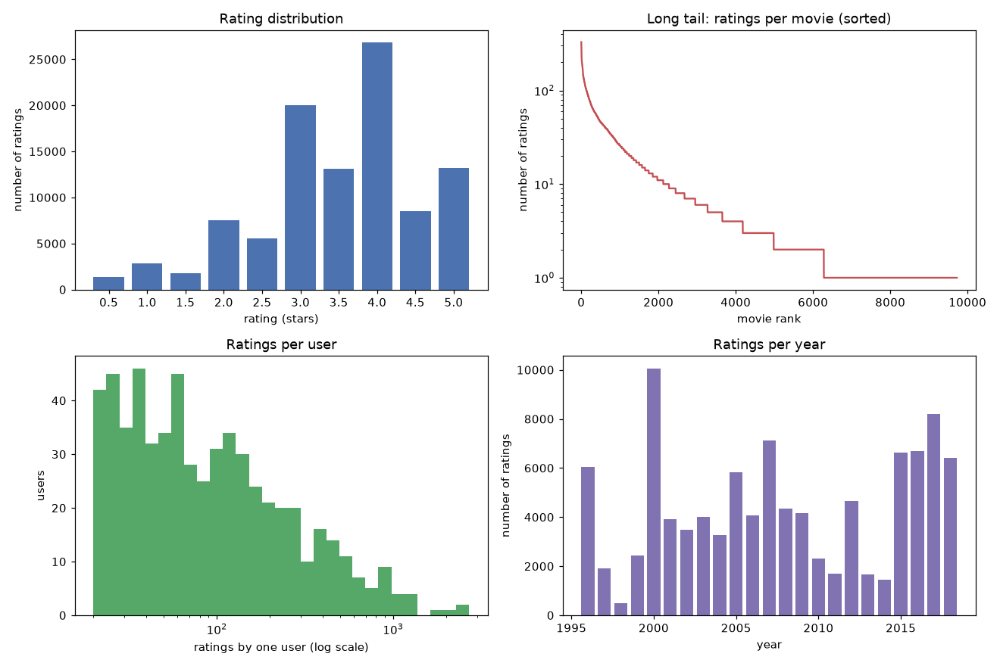
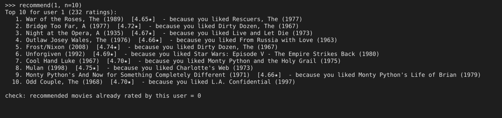

# Movie Recommendation System (MovieLens latest-small)

**One-line summary:** A hybrid movie recommender (mean-centred item-based collaborative filtering + TF-IDF content filtering over genres and tags) on MovieLens latest-small (100,836 ratings, 610 users, 9,724 movies). On a leakage-free **time-based** split it reaches **test RMSE 0.8629, 10.0% lower than the user-mean baseline (0.9592)**. A deliberate-leak experiment shows that leakage would have made item-CF RMSE look 34.6% better than it really is.

*CSE303 Machine Learning, Week 10 mini project. Topic **P01 Movie recommender (MovieLens)**. Twist: time-based vs random split. Team: `<team name>`, members: `<name 1>`, `<name 2>`.*

> Every number in this README is printed by `notebook.ipynb` (run top to bottom; results are deterministic, seed 1). This is an academic project on a *development* dataset. The numbers are course results, not research findings.

## Problem
A viewer on a streaming service has rated some films. The system recommends films they have **not** rated, as a ranked "top picks" list with a predicted star rating and a reason ("because you liked …"). The decision it supports is *what to watch next*.

## Data (source, licence, size, sparsity)
- **Source:** MovieLens `ml-latest-small`, GroupLens Research, University of Minnesota: https://grouplens.org/datasets/movielens/latest/ (generated 2018-09-26).
- **Licence:** GroupLens usage licence (see the dataset's `README.txt`): research use allowed, no commercial use without permission, no implied endorsement, redistribution only under the same licence, and the dataset must be cited:
  F. Maxwell Harper and Joseph A. Konstan. 2015. *The MovieLens Datasets: History and Context.* ACM TiiS 5(4): 19:1–19:19. https://doi.org/10.1145/2827872
- **Size:** 100,836 ratings (0.5 to 5 stars in half-star steps) by 610 users on 9,724 movies, 3,683 tag applications, 9,742 movies in `movies.csv`. Ratings run from 1996-03-29 to 2018-09-24. Every user has at least 20 ratings (median 70, max 2,698).
- **Sparsity:** 0.983 (98.3% of user × movie cells are empty).
- **Cleaning:** no missing values, duplicate pairs or off-scale ratings, so no rating rows were dropped. `(no genres listed)` (34 movies) becomes an empty genre. 5 titles shared by two movieIds get the id added for display. Tags are lower-cased and trimmed (1,589 → 1,475 distinct tags).



## Method
- **Split:** each user's most recent 20% of ratings go to **test** (time-based). A validation split is cut the same way from train, and **all tuning uses validation only**. Means, similarities, the TF-IDF vocabulary and SVD are fitted on train only. Tags a user put on one of their own test movies are removed.
- **Catalogue:** movies with ≥ 5 train ratings (3,040 movies, 15,138 of 20,164 test ratings). Every model is scored on exactly the same pairs. Rarer and brand-new movies are covered by the cold-start experiments.
- **Baselines:** global mean, user mean, item mean, most popular.
- **Content-based:** TF-IDF over genre tokens + tags, then cosine similarity. (a) item-kNN prediction (k = 40); (b) mean-centred user profile.
- **Collaborative:** item-based CF with mean-centred (adjusted) cosine, k = 40, predicting the user mean plus a similarity-weighted average of centred ratings. A **ranking variant** adds a damping term λ = 10 (k = 20) to the denominator, so predictions that rest on little evidence do not dominate the top-N.
- **Matrix factorization:** the starter `svd_scores` (TruncatedSVD on the user-centred matrix), rank 5.
- **Hybrid:** α·CF + (1 − α)·content, α = 0.8 for star prediction (validation RMSE) and α = 0.9 for ranking (validation NDCG). For cold movies, content only.

## Results (test set, time-based split, k = 5, relevant = rating ≥ 4)

| Model | RMSE | precision@5 | recall@5 | NDCG@5 | coverage@5 |
|---|---|---|---|---|---|
| global mean | 1.0403 | – | – | – | – |
| user mean | 0.9592 | – | – | – | – |
| item mean | 0.9698 | 0.0034 | 0.0007 | 0.0032 | 0.0033 |
| most popular | – | 0.0700 | 0.0326 | 0.0800 | 0.0191 |
| content item-kNN (genres + tags) | 0.9297 | 0.0174 | 0.0050 | 0.0157 | 0.1526 |
| content user-profile | – | 0.0123 | 0.0059 | 0.0133 | 0.3234 |
| item-CF raw cosine (contrast) | 0.8938 | 0.0239 | 0.0049 | 0.0256 | 0.2691 |
| item-CF centred cosine | 0.8662 | 0.0205 | 0.0028 | 0.0190 | 0.3664 |
| SVD (k = 5) | 0.9324 | 0.0778 | 0.0309 | **0.0848** | 0.0655 |
| **hybrid (α = 0.8)** | **0.8629** | 0.0235 | 0.0037 | 0.0238 | 0.3612 |
| item-CF ranking variant (k = 20, λ = 10) | 0.9198 | 0.0655 | 0.0287 | 0.0696 | 0.2987 |
| hybrid ranking variant (α = 0.9, damped) | 0.9189 | 0.0648 | 0.0291 | 0.0724 | 0.3115 |

"–": global and user mean give one score per user, so they cannot rank; most popular is a count, not a rating.

- **RMSE:** the hybrid is best (0.8629). Item-CF beats user mean by 0.093, with a 95% user-bootstrap interval of [−0.107, −0.080]. The hybrid's extra gain over item-CF is small but positive: −0.0033, interval [−0.0058, −0.0007].
- **Ranking:** no model beats *most popular* on NDCG@5 by a margin we can trust (SVD − popular: +0.0048, interval [−0.0067, +0.0170]). The damped ranking variants reach similar accuracy with **16× the catalogue coverage** (31% vs 1.9%). The model with the best RMSE (plain item-CF) ranks poorly (NDCG@5 0.0190). Damping lifts it to 0.0696.
- **Twist (random vs time split):** a random split overstates quality. Most-popular NDCG@5 is 0.1755 ± 0.0060 (3 seeds) vs 0.0800, SVD 0.1618 vs 0.0848, and item-CF RMSE 0.8343 vs 0.8662.

Demo (`recommend(1, n=10)`):



Across all 610 users, the number of already-rated movies recommended is **0**.

## Understanding pack
- **By-hand check (Section 12):** user 114 → *Spider-Man 3 (2007)*. The three positive neighbours have similarities 0.033041, 0.027367 and 0.022044 and ratings 0.5, 4.5 and 4.5. The user mean is 3.42. 3.42 + (−0.043116 / 0.082452) = **2.8971**. The code gives **2.8971**.
- **Deliberate leak (Section 13a):** similarities and means fitted on train + test. Item-CF RMSE goes from 0.8662 to 0.5666 (looks 34.6% better) and NDCG@5 from 0.0190 to 0.2007. SVD RMSE goes from 0.9324 to 0.8620.
- **Break-it tests (Section 11):**
  - New user: popularity fallback.
  - New movie: CF gives only the user mean, while content finds sensible neighbours.
  - One-rating or all-5-star user: every centred rating is 0, so 3,649 movies tied for first place. Fixed by shrinking the user mean towards the global mean (one movie at the top afterwards, and validation RMSE unchanged: 0.8583 vs 0.8582).
- **Cold start (Section 9):**
  - Hiding all ratings of 10% of movies: CF falls back to the user mean (RMSE 0.966), content scores 0.947 (0.943 damped).
  - Truly new movies (no train ratings): content (1.034, or 1.019 damped) did **not** beat the user mean (1.001). Only genres are available for them, and only 0.4% have a usable tag.
- **Decision log (10 entries), bug log (4 entries), AI-use log:** Sections 13b, 13c and 14 of the notebook.

## Limitations
- Offline evaluation only: no A/B test, so clicks and watch time are not measured. RMSE and NDCG on 610 users of a development dataset are noisy (see the bootstrap intervals).
- On this time split, personalised ranking does not significantly beat most-popular. A large share of each user's "future" movies are popular titles.
- Content features are thin (genres plus user tags, and only 1,048 of 3,040 catalogue movies have a tag), so content does not help truly new movies. TMDB overviews and keywords via `links.csv` would be the next step.
- The simple SVD fills unrated cells with 0 (no deviation from the user mean), which biases it towards the mean. ALS or FunkSVD fitted on observed cells only would be fairer.
- Movies with fewer than 5 train ratings are left out of the main table, and dense similarity matrices would not scale to the full MovieLens dataset.

## AI-use note
Claude (Anthropic) was used to read the brief, write the notebook code, run it and draft this README. Every number was produced by running the notebook. Two real AI mistakes were caught by running the code (see the bug log): a pandas `.item` method clash and a ranking model that recommended obscure movies. **The team still has to complete the "What I checked or changed" column of the AI-use log (Section 14) in its own words.**

## How to run
**VS Code (local):**
```bash
python -m venv .venv
source .venv/bin/activate          # Windows: .venv\Scripts\activate
pip install -r requirements.txt
# put ratings.csv, movies.csv, tags.csv, links.csv in ./data  (or let the notebook download them)
```
Open `notebook.ipynb` in VS Code, pick the `.venv` kernel, and click **Run All**. A full run took about 5 minutes on a 2-core, 8 GB machine.

**Google Colab:** upload `notebook.ipynb` and **Run all**. The first cell of Section 2 downloads the dataset from GroupLens if `data/` is missing.

## Repo layout
```
labs/week10_recsys/<team_name>/
├── notebook.ipynb      full pipeline, run top to bottom, outputs saved
├── README.md
├── requirements.txt
├── cv_bullet.txt
├── data/README.md      how to download the data (raw CSVs are not committed)
└── figures/            plots and the results table written by the notebook
```
